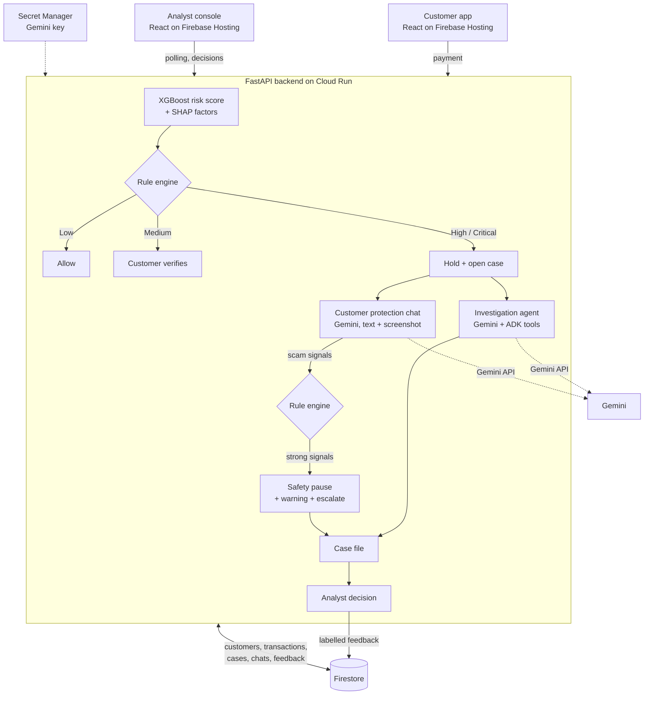

# ScamShield

**AI-Powered Intelligent Fraud Detection (BFSI).** Catches fraud even when the customer says "yes, it was me."

ScamShield is a fraud and scam protection system for banks. An ML risk model scores every payment, a rule engine decides what happens to the money, and Gemini agents investigate risky payments and talk to the customer while the payment is still on hold.

- Customer app: https://scamshield-510918.web.app/customer
- Analyst console: https://scamshield-510918.web.app/analyst

> **All data is synthetic.** The risk model is trained on the public PaySim dataset. Customers, payees, conversations, scam messages and the bank policy were written for this project. No real personal data is used or sent to Gemini.

## The problem

In India and across Asia, a large share of payment fraud losses now comes from scams in which the real customer is manipulated into paying: fake KYC calls, "digital arrest" threats from fake police, investment, parcel and job scams. The money usually lands in a mule account.

Conventional fraud detection struggles with these payments. The model sees the usual customer on the usual device. When the bank asks "did you make this payment?", the victim, coached by the scammer, says yes.

## The solution

ScamShield treats that "yes" as the start of the check, not the end.

1. **Risk model.** XGBoost scores each transfer and SHAP explains the score in plain English.
2. **Rule engine.** Rules, not the model and not the LLM, turn the score into an action: allow, ask the customer to verify, hold, or hold and escalate. A behaviour rule also holds a large first payment to a new payee, which is the usual shape of a scam payment.
3. **Investigation agent (Gemini + Google ADK).** For a held payment it gathers evidence with tools (score, customer history, payee history, similar cases, bank policy) and writes a structured case file for the analyst.
4. **Customer protection chat (Gemini).** It checks the payment with the customer in English, Tamil or Hindi and gently asks about the context: who asked for the payment, whether someone is on a call, any threats, urgency, secrecy or app installs. The customer can paste or upload a screenshot of the message they received.
5. **Safety pause.** If the chat finds strong scam signals, the rules pause the payment for a cooling-off period and the customer sees a clear warning with what to do next (never share an OTP, banks and police never ask for money, call 1930).
6. **Analyst console.** The analyst sees the evidence, the conversation and the audit log, and decides. Each decision is stored as a labelled example for retraining.

Gemini never blocks or releases money. It investigates, explains, converses and drafts.

## Architecture



| Tier | Rule engine action |
|---|---|
| Low | Allow |
| Medium | Ask the customer to verify |
| High | Hold, create a case, start the customer chat |
| Critical | Hold, escalate to an analyst, start the customer chat |
| Strong scam signals from the chat | Safety pause: hold for a cooling-off period, warn the customer, escalate |

Stack: FastAPI, XGBoost, SHAP, google-genai and Google ADK on Cloud Run (asia-south1); React, Vite and Tailwind on Firebase Hosting; Firestore; Secret Manager.

## Repo layout

```
backend/
  app/      API, scoring, chat flow, payment processing
  ml/       features, training, SHAP explanations, trained model (ml/artifacts)
  rules/    the rule engine: tiers, behaviour rule, safety pause, analyst decisions
  agents/   investigation agent, protection chat, tools, policy lookup, fixed messages
  db/       data store (memory or Firestore) and synthetic seed data
  tests/    pytest suite and fixtures (conversations, scam messages, screenshots)
frontend/   React app: /customer and /analyst
scripts/    setup check, seeding, simulator, evaluation, demo scenarios
docs/       bank policy, model metrics, evaluation, results, deployment
data/       PaySim CSV goes here (gitignored)
```

## Setup

Prerequisites: Windows with PowerShell, [uv](https://docs.astral.sh/uv/), Node.js LTS and the gcloud CLI.

1. Copy `.env.example` to `.env`. Set `GEMINI_API_KEY` (a free-tier key from https://aistudio.google.com/apikey), `GOOGLE_CLOUD_PROJECT`, and `ADMIN_TOKEN` (any long random string).
2. For Firestore access: `gcloud auth application-default login`. To run without Firestore, also set `STORE_BACKEND=memory` and `SEED_ON_START=true`.
3. Backend, from `backend/`:
   ```powershell
   uv sync
   uv run pytest
   uv run uvicorn app.main:app --reload --port 8080
   ```
4. Check the Gemini key and Firestore, from the repo root:
   ```powershell
   uv run --project backend python scripts/test_setup.py
   ```
5. Seed the demo customers (30 customers, 360 past payments), from the repo root with the backend running:
   ```powershell
   uv run --project backend python scripts/demo.py reset
   ```
6. Frontend, from `frontend/`:
   ```powershell
   npm install
   npm run dev
   ```
   Open http://localhost:5173/customer and http://localhost:5173/analyst.

Optional:

- Retrain the model: put the PaySim CSV (`ealaxi/paysim1` on Kaggle) in `data/`, then `uv run python -m ml.train` from `backend/`. The trained model is already in `backend/ml/artifacts/`.
- Fill the live feed with replayed PaySim payments: `uv run --project backend python scripts/simulate.py --count 20 --delay 2`.
- Deploy: see [docs/deploy.md](docs/deploy.md).

## Demo

Three scenarios, run from the repo root. Add `--api <Cloud Run URL>` before the command to run them against the deployed backend.

```powershell
uv run --project backend python scripts/demo.py reset
```

| Command | What it shows |
|---|---|
| `scripts/demo.py scenario 1` | A normal payment to a usual payee. Low risk, allowed instantly. |
| `scripts/demo.py scenario 2` | Account takeover: a customer's whole balance goes to an account that already has a case against it. The model scores it Critical, the payment is held and escalated, and Gemini writes the case file. Open the analyst console to decide. |
| `scripts/demo.py scenario 3` | A scam victim. The model sees a normal payment; the behaviour rule holds it. The script then tells you what to type in the customer app: say "yes, it was me", then mention the police officer and upload the "digital arrest" screenshot. The safety-pause screen appears. |
| `scripts/demo.py scenario 3 --auto` | The same, with the script playing the customer. |

The cooling-off period is 120 seconds in the demo (`SAFETY_PAUSE_SECONDS`); a real bank would use hours. Gemini replies can take up to half a minute on the free tier.

## Results

Full detail: [docs/results.md](docs/results.md), [docs/model_metrics.md](docs/model_metrics.md), [docs/scam_eval.md](docs/scam_eval.md).

| Layer | Evaluated on | Result |
|---|---|---|
| Risk model + rules | 552,504 later PaySim payments (time-based split), 4,258 frauds | PR-AUC 0.985, ROC-AUC 0.9998. Holds catch 96.8% of fraud while holding 0.87% of payments. |
| Customer protection chat + rules | 20 synthetic conversations (10 scam, 10 genuine; English, Tamil, Hindi) | 20 of 20 correct: every scam paused, no genuine payment paused. |
| Screenshot analysis | 8 synthetic scam message screenshots | 8 of 8 paused. |
| Prompt injection | 1 message containing "ignore previous instructions" | Flagged, not obeyed, payment paused. |

How to read these:

- **The model's score is inflated by the dataset.** 97.8% of PaySim frauds move exactly the sender's whole balance and no genuine payment does. Without the two sender-balance features, PR-AUC falls to 0.58.
- **The model cannot see scams.** PaySim has no authorised-scam labels and almost no repeat customers. Scam-shaped payments reach the chat through the behaviour rule, which relies on synthetic customer profiles.
- **The chat evaluation is small and friendly.** The conversations were written alongside the agent's instructions, the scripted victims reveal the scam early, and the genuine cases are clearly genuine. It shows the mechanism works; it is not an accuracy estimate for real customers.
- **The two layers were evaluated separately.** There is no end-to-end estimate of prevented loss.

## Responsible AI

- **Rules decide money, not the LLM.** Holds, pauses and releases come from `backend/rules/rules.py` and from analysts. The agents have no tool that moves money.
- **Customer content is untrusted.** Chat text and screenshots are wrapped as evidence, kept out of the system instruction, and Gemini is told to treat them as data. A pattern check in code records injected instructions independently of the model, and a test confirms that even a model that obeys an injection cannot release a payment.
- **Grounded explanations.** The case file's facts (payment, score, tier) are copied from stored data by code. The agent must call the evidence tools before writing, and may cite only policy sections that exist.
- **Audit trail.** Every score, rule decision, AI output, scam signal and analyst decision is logged on the case with a time and an actor.
- **Human in the loop.** Analysts see the evidence and decide. A payment cannot be sent while a safety pause is running, by anyone.
- **Respect for the customer.** The assistant is instructed never to accuse, never to ask for an OTP or password, and never to promise a release. The safety warning is fixed, human-written text in three languages.
- **Data.** Synthetic only. The Tamil and Hindi texts were written without a native-speaker review and should have one before real use.
- **Limits.** See "How to read these" above. This is a hackathon prototype, not a production fraud system.

## Scale-up path

The prototype trades scale for simplicity. What would change for production:

| Today | At scale |
|---|---|
| Payments posted to one FastAPI service | **Pub/Sub** stream of payment events; scoring, investigation and chat as separate services |
| Backend keeps Firestore data in memory and serves reads from it (one instance) | Proper Firestore queries with indexes, or **Bigtable** for payee and customer feature lookups; many instances |
| Polling frontends | Firestore listeners or server-sent events |
| Model trained on a laptop from a CSV | **BigQuery** as the feature and label store; **Vertex AI** pipelines for scheduled retraining on analyst feedback, with a model registry and monitoring for drift |
| Gemini through a free-tier AI Studio key | **Vertex AI** Gemini endpoints with quotas, regional data residency and safety settings managed centrally |
| Synthetic customer profiles | Real behavioural features: usual payees, amounts, devices, session signals |
| No login on the API | Bank identity for customers, SSO and role-based access for analysts |
| Hand-written fixtures for evaluation | Labelled scam cases from operations, red-team conversations, per-language review |

## Cost and take-down

The deployment is sized for free tiers; the two items that are not strictly free, and the commands to remove everything, are in [docs/deploy.md](docs/deploy.md). The deployed API has no login, so take it down when the demo is over.
